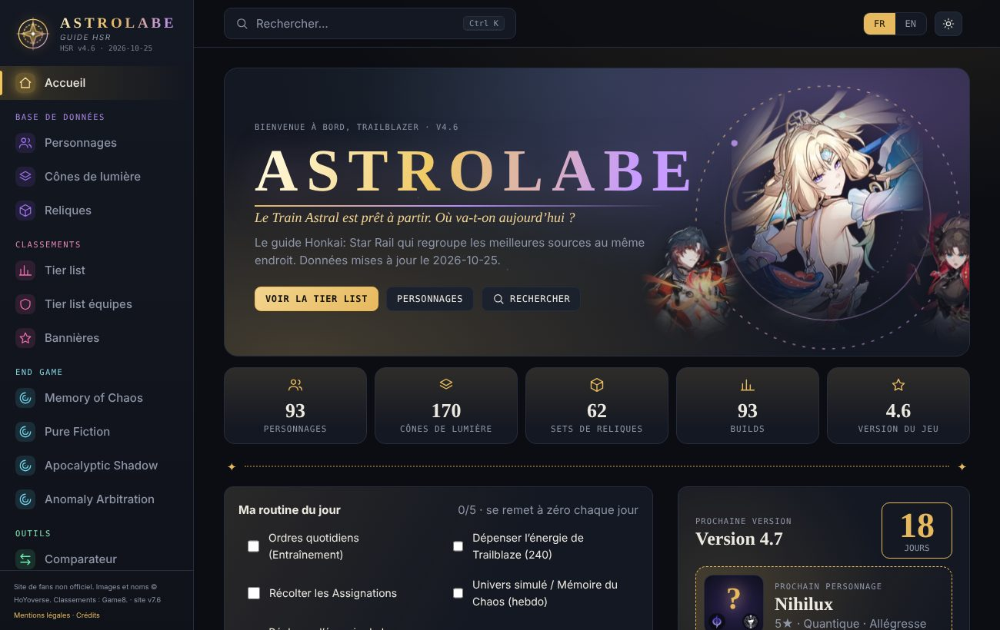
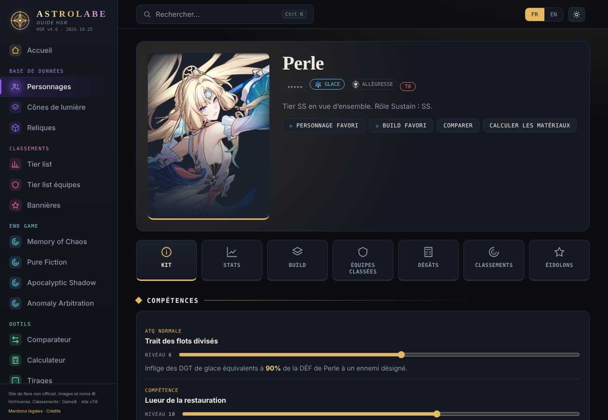
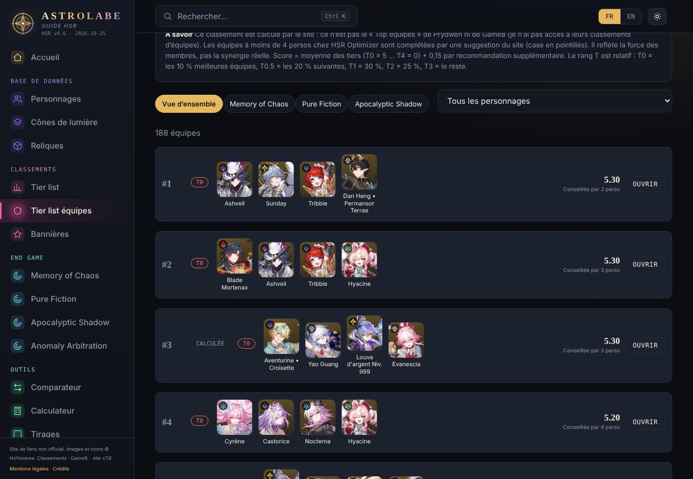
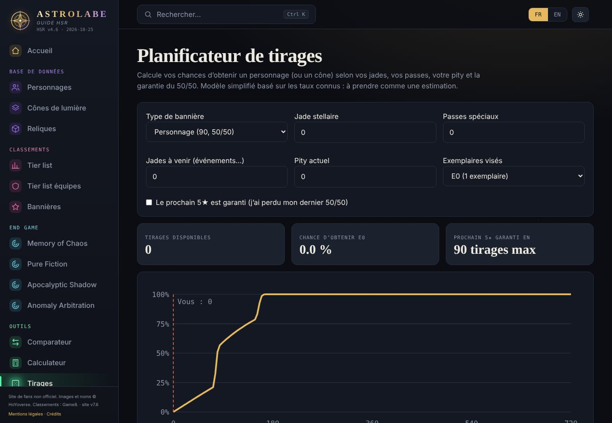
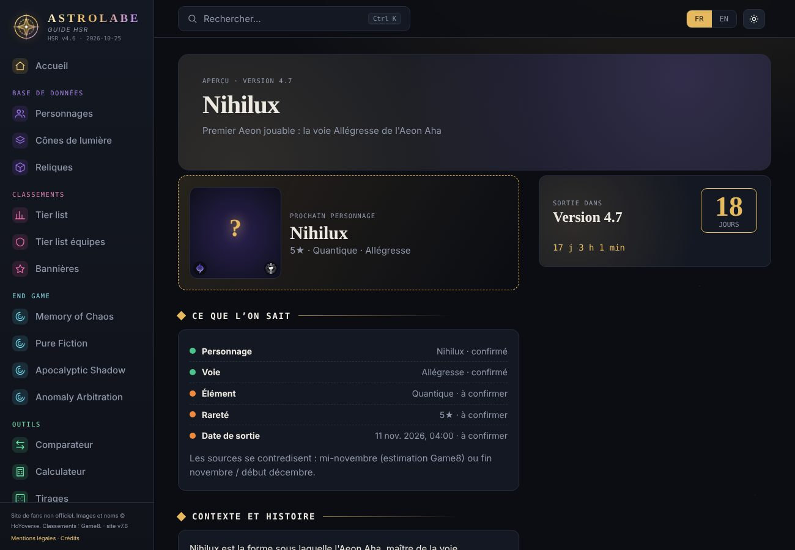
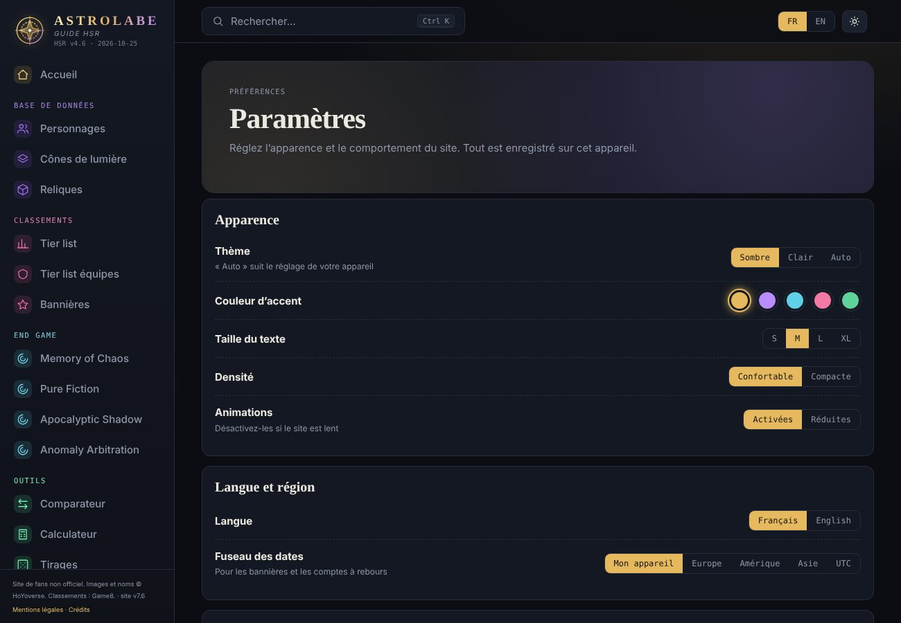

# ASTROLABE
### Le guide Honkai: Star Rail, gratuit et mis à jour automatiquement

**[👉 Ouvrir le site](https://kdvershsr.github.io/Astrolabe/)**

*Tier list · Builds · Équipes · Bannières · Outils · Communauté*

> **Site de fans non officiel**, gratuit, sans publicité et sans but lucratif. Honkai: Star Rail et tout son contenu (personnages, noms, images, textes) appartiennent à HoYoverse. Aucun lien avec HoYoverse.

## Pourquoi Astrolabe ?
Faire gagner du temps aux joueurs : tout ce qu'il faut pour préparer ses tirages, ses équipes et son end game réuni au même endroit, en **français et en anglais**, et qui **se met à jour tout seul** chaque lundi.

## Ce que vous trouverez sur le site

### 📚 Base de données
- **93 personnages** : kit complet (niveau réglable), stats par niveau, build recommandé (reliques, ornements, cônes, statistiques secondaires), équipes conseillées, classements, éidolons et estimation des dégâts.
- **170 cônes de lumière** et **62 sets de reliques et d'ornements planaires**, avec leurs effets.

### 🏆 Classements
- **Tier list** par vue d'ensemble, par rôle (DPS, Support, Sustain) et par mode end game (Memory of Chaos, Pure Fiction, Apocalyptic Shadow), sur l'échelle T0 → T4, avec flèches de tendance et filtres (élément, voie, rareté, éidolon).
- **Tier list des équipes** : classement calculé par le site à partir du niveau des membres et de leur synergie. Les équipes de moins de 4 personnages sont complétées par une suggestion.
- **Équipes calculées** pour chaque personnage, d'après la synergie des kits (éléments, voies, mots-clés comme Allégresse, dégâts sur la durée, Rupture, mémosprites).
- **Bannières** en cours et à venir, avec comptes à rebours et rappel 24 h avant la fin (fichier calendrier + notification).
- **Calendrier end game** automatique pour les quatre modes, dont Anomaly Arbitration.

### 🛠️ Outils
- **Comparateur** de personnages.
- **Calculateur de matériaux** d'ascension et de compétences.
- **Planificateur de tirages** : chance d'obtenir un personnage ou un cône selon vos jades, passes, pity et 50/50, avec courbe de probabilité.
- **Simulateur de tirages** pour s'amuser (pity, 50/50, animation).
- **Constructeur d'équipes** enregistrables et partageables par lien, avec un **score de synergie** et des alternatives.
- **Mes équipes possibles** : d'après votre collection, les équipes que vous pouvez jouer, celles à un personnage près et les personnages à tirer en priorité.

### 📖 Guides
- **Résumé de chaque version**, de la 1.0 à la 4.7, avec une image marquante, l'arc narratif, les nouveautés et un mode « sans spoiler ».
- **Prochaine version** : teaser du prochain personnage, ce qui est confirmé ou non, compte à rebours.
- **Centre d'aide** et événements.

### 👥 Communauté
- **Profils** (collection, favoris, équipes) et **profils publics** avec vitrine, statistiques et « j'aime ».
- **Succès** (28 badges à débloquer).
- **Statistiques** anonymes de ce que jouent les joueurs du site.
- Connexion par **e-mail**, **double authentification** (application d'authentification), suppression du profil et du compte en un clic.

### ⚙️ Confort
- **Paramètres** : thème sombre, clair ou auto, 5 couleurs d'accent, taille du texte, densité, animations réduites, langue, fuseau horaire des dates, échelle de la tier list, page d'ouverture, export et import de vos données.
- **Installable** sur téléphone et ordinateur (PWA), avec consultation hors-ligne.
- **Routine du jour** à cocher sur l'accueil.
- Recherche rapide (`Ctrl + K`), adapté au mobile.

## Captures d'écran
| Tier list | Fiche personnage |
|---|---|
|  |  |
| **Tier list des équipes** | **Planificateur de tirages** |
|  |  |
| **Prochaine version** | **Paramètres** |
|  |  |

## 🔄 Mise à jour automatique
Chaque **lundi à 05:00 UTC**, un robot GitHub (GitHub Actions) met le site à jour sans intervention :

| Automatique chaque lundi | À la main, à chaque version |
|---|---|
| Personnages, cônes, reliques, compétences, images | Résumé de l'histoire de la version |
| Builds et équipes conseillées | Tier list (Game8 bloque les robots : mise à jour à chaque version) |
| Bannières et calendrier end game | Collaborations et guides |
| Équipes calculées et tier list des équipes | |
| Date de la prochaine version, fiche du nouveau personnage dès qu'il existe | |

Une page **« Statut des données »** (page Aides) indique l'état de chaque source, et une alerte GitHub est créée si la mise à jour échoue.

## 📦 D'où viennent les données ?
| Source | Utilisation |
|---|---|
| [StarRailRes](https://github.com/Mar-7th/StarRailRes) | Données du jeu et images |
| [HSR Optimizer](https://github.com/fribbels/hsr-optimizer) | Builds et équipes conseillées |
| [Game8](https://game8.co/games/Honkai-Star-Rail/archives/409604) | Tier list (convertie en T0 → T4) |
| [Ennead API](https://api.ennead.cc) | Bannières et calendrier end game |
| [Supabase](https://supabase.com) | Comptes et profils |

Les équipes « calculées », les scores de synergie et les estimations de tirages sont produits par le site : **ils sont indicatifs** et peuvent contenir des erreurs.

## 🧱 Technique
Site statique en JavaScript pur (aucun framework), hébergé sur **GitHub Pages**. Mise à jour par un script Python (`scripts/update.py`) exécuté par **GitHub Actions**. Comptes, profils et sécurité (RLS, double authentification) via **Supabase**. Pour installer ou maintenir le projet : [docs/MAINTENANCE.md](docs/MAINTENANCE.md).

## 🙏 Remerciements et mentions
Merci aux auteurs des projets ci-dessus. Mentions légales, confidentialité et crédits complets : voir les pages **Mentions légales** et **Crédits** du site. Pour signaler une erreur ou demander un retrait, utilisez le bouton « Signaler » du site ou ouvrez une *issue*.

---

<b>🇬🇧 English summary</b>

**Astrolabe** is a free, ad-free, unofficial fan guide for *Honkai: Star Rail*, in French and English, updated automatically every Monday.
It includes 93 character pages (kit, build, teams, eidolons, damage), 170 light cones, 62 relic sets, a tier list (T0 → T4) and a computed team tier list, banners with countdowns and reminders, an end game schedule, a materials calculator, a pull planner and simulator, a team builder with synergy score, version recaps from 1.0 to 4.7, a next-version teaser, player profiles with achievements, two-factor authentication, settings (themes, accent colours, text size…), and an installable offline-capable app (PWA).
Honkai: Star Rail and its content belong to HoYoverse. This project is not affiliated with HoYoverse.

