

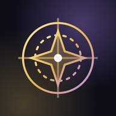

# ASTROLABE · FOILVAULT · BLEACH: MIRRORS HIGH
### Three free fan sites in one place, refreshed automatically every Monday

**[👉 Open the site](https://kdvershsr.github.io/Astrolabe/)**

*Honkai: Star Rail guide · collectible gacha card game · Bleach: Mirrors High info hub*

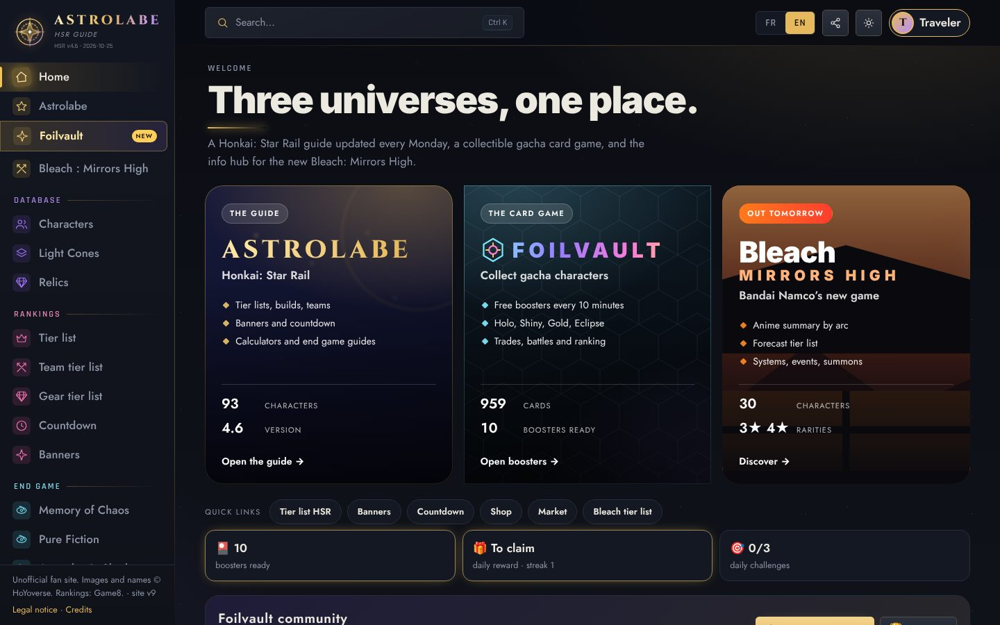

> **Unofficial fan project.** Free, ad-free and non-profit. Honkai: Star Rail, Bleach and every other game or series mentioned, with their characters, names, images and texts, belong to their respective owners (HoYoverse, Bandai Namco, Shueisha/Tite Kubo, Sega/Atlus and others). No affiliation with any of them. Nothing can be bought on this site.

## The three sites

| | |
|---|---|
| **Astrolabe** Honkai: Star Rail guide | Characters, light cones, relics, tier lists, banners, calculators and community tools. |
| **Foilvault** Collectible gacha card game | Open boosters, collect over 950 characters from 20+ games, trade and battle. |
| **Bleach: Mirrors High** Launch hub | Anime by arc, forecast tier list, systems, events and a summon planner for the game released on 28 October 2026. |

Each site has its own look: Astrolabe is gold and violet, Foilvault is cyan and holographic with a hex-grid backdrop, Bleach is black, orange and white.

---

## 🌌 Astrolabe — Honkai: Star Rail guide

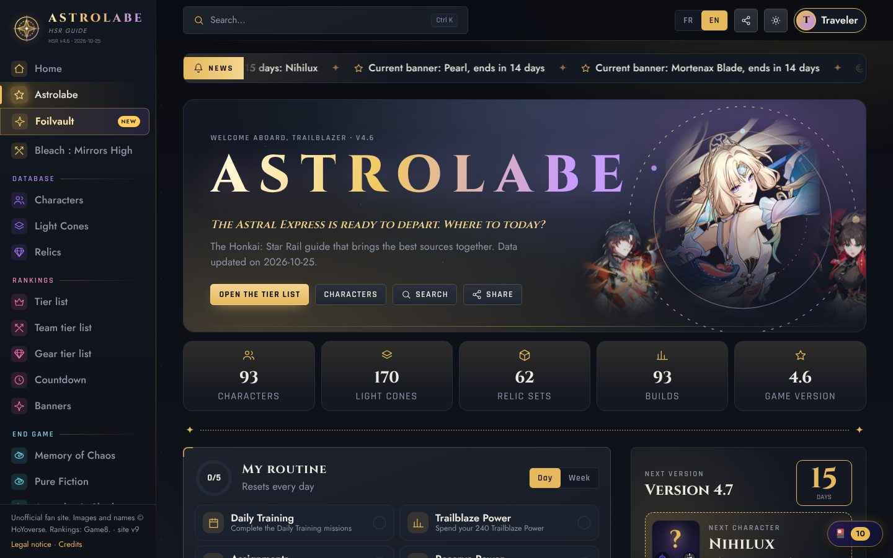

- **Database**: 93 characters (full kit with adjustable level, stats, recommended build, suggested teams, eidolons, damage estimate), 170 light cones and 62 relic and planar sets.
- **Rankings**: overall, by role and by end game mode (Memory of Chaos, Pure Fiction, Apocalyptic Shadow) on a T0 → T4 scale, with trend arrows and filters. A computed team tier list ranks teams from member levels and synergy.
- **Banners and calendar**: current and upcoming banners with countdowns, plus an automatic end game calendar.
- **Tools**: character comparator, materials calculator, pull planner (pity and 50/50 probability curve), pull simulator, shareable team builder with a synergy score, and "teams I can play" from your collection.
- **Guides**: recap of every version from 1.0 to the latest (with a no-spoiler mode), next-version teaser, help centre.
- **Community**: profiles with showcase and likes, 28 achievements, anonymous play statistics, e-mail sign-in with two-factor authentication.

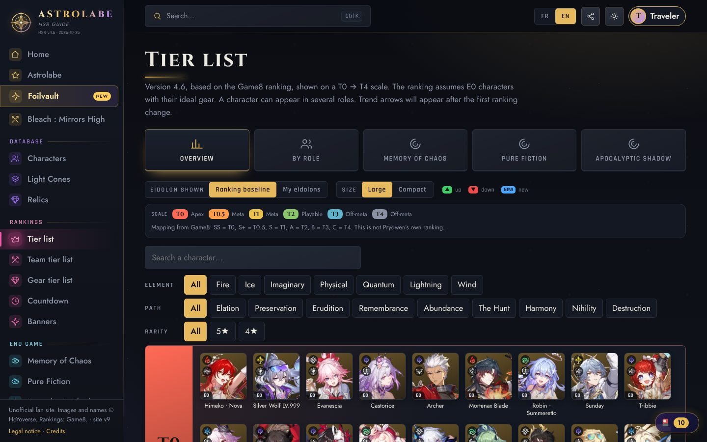

## 🃏 Foilvault — the collectible card game

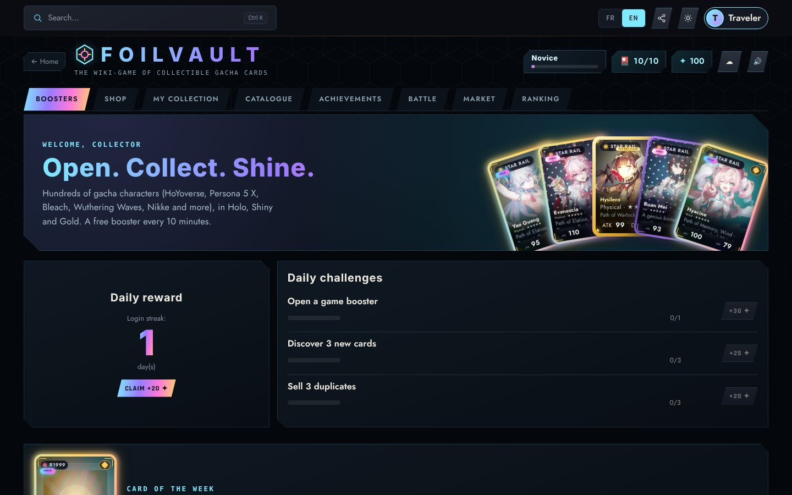

- **959 cards** from 20+ gacha games, including Honkai: Star Rail, Genshin Impact, Zenless Zone Zero, Wuthering Waves, Reverse: 1999, Nikke, Fate/Grand Order, Persona 5: The Phantom X and Bleach: Mirrors High.
- **Boosters**: a free general booster every 10 minutes, game boosters and a Prestige booster bought with in-game shards (earned, never purchased).
- **"Vault ritual" opening**: cut the pack with a swipe, cards are dealt face down, then revealed one by one, with a spotlight for Epic and above.
- **Finishes**: Normal, Holo, Shiny, Gold and a rare Eclipse variant. Rarity follows each character's place in the game's current tier list.
- **Play**: collection and catalogue, daily reward and challenges, achievements, battles, a market to trade duplicates, and a ranking.
- Progress is stored in your browser, and can be exported, imported and synced to your account.

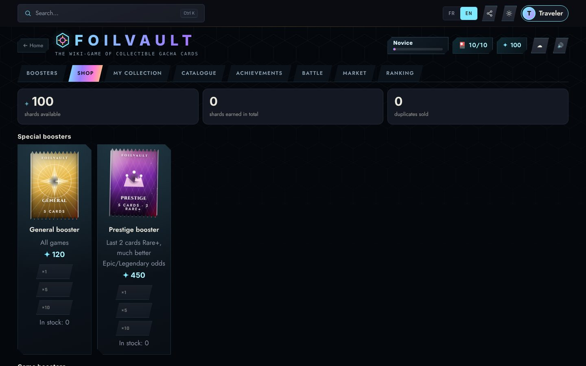

## ⚔️ Bleach: Mirrors High — launch hub

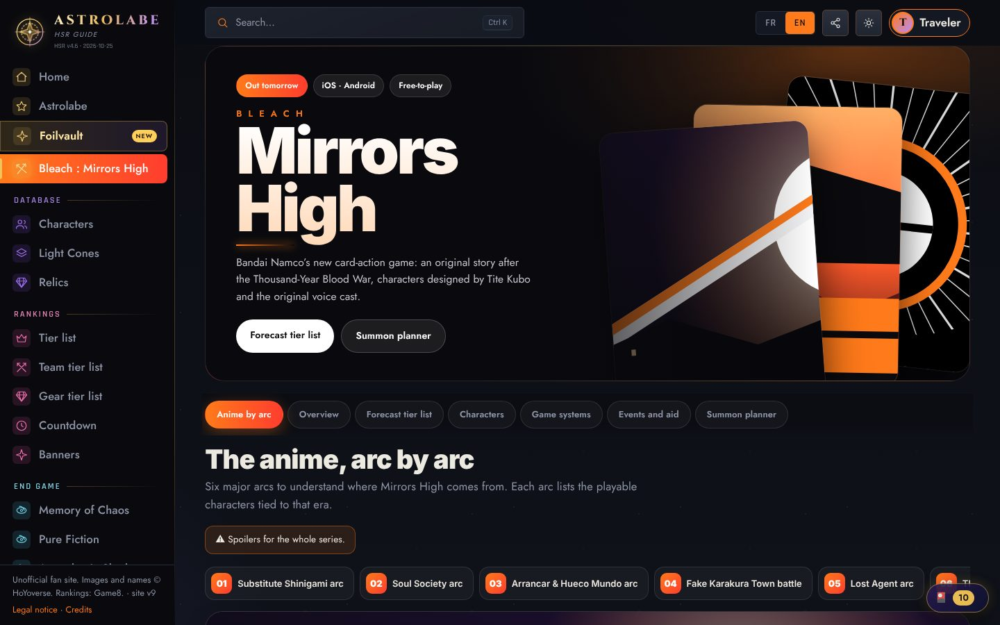

- **The anime, arc by arc**: six arcs, each with a large illustration, a spoiler-tagged summary, the main antagonist and the playable characters tied to it.
- **Forecast tier list**: clearly labelled as an estimate. It is checked every Monday against public tier lists and updated when enough characters are recognised.
- **Systems, events and aid**: confirmed information (launch, pre-registration rewards) is separated from likely information.
- **Summon planner** based on the announced reward (9,000 Mirror Gems = 30 summons).

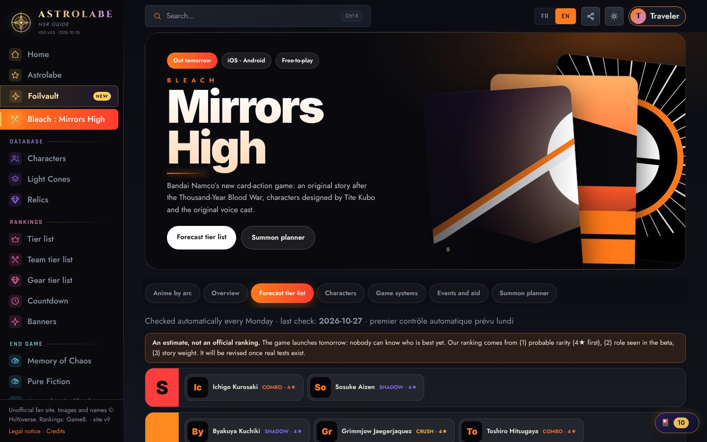

---

## 📱 Made for phones
Installable as an app (PWA), with a bottom bar that adapts to the site you are on, safe-area support, standalone mode and offline access to your cards.

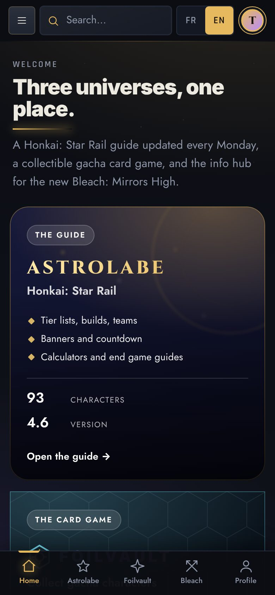
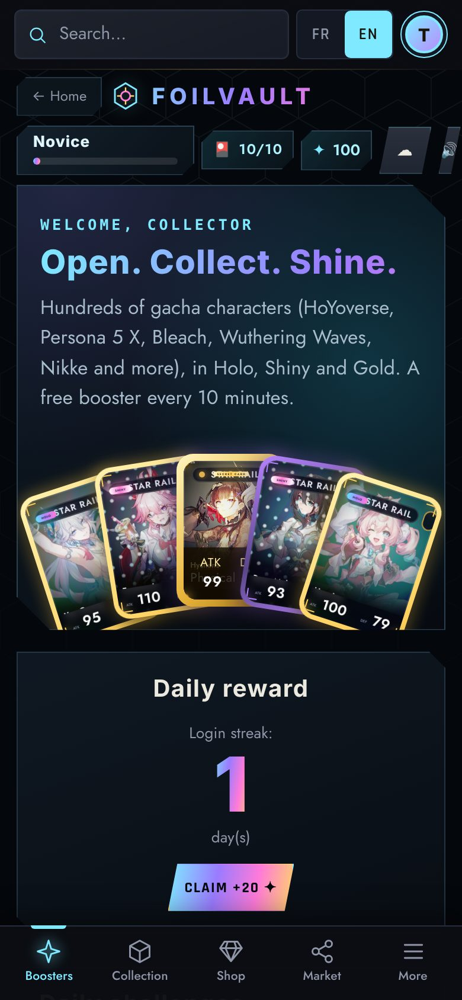
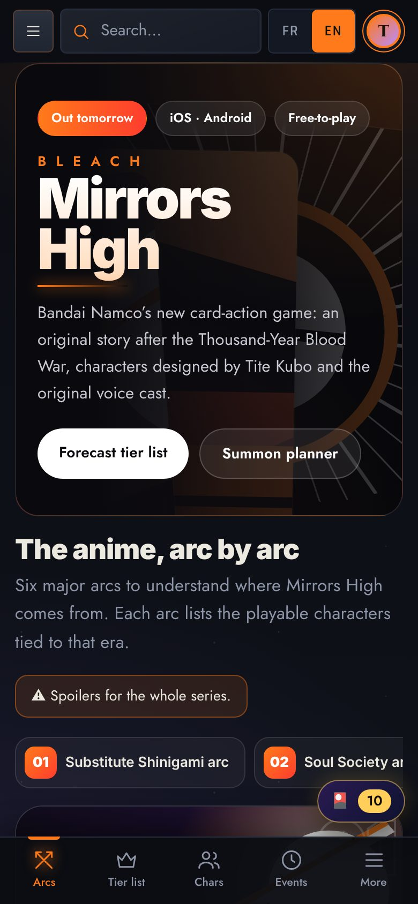

*On iPhone: Safari → Share → Add to Home Screen. On Android: browser menu → Install app.*

## 🔄 Automatic updates
A GitHub Actions workflow runs **every Monday at 05:00 UTC** (and on demand with *Run workflow*).

| Step | What it does |
|---|---|
| `scripts/update.py` | Refreshes Honkai: Star Rail data, builds, teams, banners and calendar. Tier list from Game8, with **[Prydwen](https://www.prydwen.gg/star-rail/tier-list)** as a backup source. The previous ranking is kept if both fail. |
| `scripts/bmh_update.py` | Looks for public Bleach: Mirrors High tier lists and updates `data/bmh_tiers.json` when at least 10 characters are recognised. Add `"manual": true` to that file to pin your own ranking. |
| `scripts/cards.py --art` | Retries missing card images each week. A quality gate rejects images that are too small, banner-shaped, flat or mostly transparent. Writes `data/img_report.json`. |
| `scripts/bleach_art.py` | Fetches the arc illustrations for the Bleach page. |

A **data status** page shows each source's state, and a GitHub issue is opened if the workflow fails.

## 📦 Data sources
| Source | Used for |
|---|---|
| [StarRailRes](https://github.com/Mar-7th/StarRailRes) | Honkai: Star Rail data and images |
| [HSR Optimizer](https://github.com/fribbels/hsr-optimizer) | Builds and suggested teams |
| [Game8](https://game8.co/games/Honkai-Star-Rail/archives/409604) · [Prydwen](https://www.prydwen.gg/star-rail/tier-list) | Honkai: Star Rail tier list (converted to T0 → T4) |
| [Ennead API](https://api.ennead.cc) | Banners and end game calendar |
| AniList, Fandom wikis, Wikipedia | Card and arc illustrations, matched by exact character name |
| [Supabase](https://supabase.com) | Accounts, profiles and trading |

Computed teams, synergy scores, pull estimates and the Bleach forecast tier list are produced by the site and are **indicative only**.

## 🧱 Technical notes
A static site in plain JavaScript (no framework), hosted on **GitHub Pages**, with Python scripts run by **GitHub Actions**. Accounts, profiles and security (row-level security, two-factor authentication) use **Supabase**. French and English are both supported. To install or maintain the project, see [docs/MAINTENANCE.md](docs/MAINTENANCE.md) and the change log in [docs/NOUVEAUTES_ET_MISE_EN_LIGNE.md](docs/NOUVEAUTES_ET_MISE_EN_LIGNE.md) (in French).

## 🙏 Credits and notices
Thanks to the authors of the projects above. Full legal notice, privacy policy and credits are on the **Legal notice** and **Credits** pages of the site. To report a mistake or request a removal, use the site's report button or open an issue.
